<div align="center">


<br/>

<a href="https://ahmedkhaledhussein.vercel.app"></a>
<a href="https://www.linkedin.com/in/ahmedkhaledhussein/"></a>
<a href="mailto:Ahmed.khaaledh@gmail.com"></a>
<a href="https://wa.me/201043263308"></a>

</div>

---

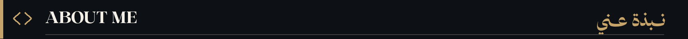

I'm **Ahmed Khaled Hussein — أحمد خالد حسين**, a software engineer and full-stack developer based in Cairo, Egypt. I'm studying Computer Science at **Arab Open University** and enjoy building polished, useful digital products.

أنا **أحمد خالد حسين**، مهندس برمجيات ومطور تطبيقات ويب متكاملة. أهتم بالذكاء الاصطناعي والرؤية الحاسوبية، وبناء تطبيقات تجمع بين جودة التصميم والتنفيذ التقني.

```ts
const ahmed = {
  name: "Ahmed Khaled Hussein",
  basedIn: "Cairo, Egypt",
  studying: "Computer Science · Arab Open University",
  role: "Software Engineer · Full-Stack Developer",
  interests: ["Web Applications", "AI", "Computer Vision", "UI/UX"],
  motto: "Build useful things, beautifully.",
};
```

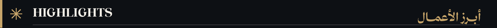

- 🚀 Developed and published my [personal portfolio](https://ahmedkhaledhussein.vercel.app) showcasing technical work and professional background.
- 🧩 Worked on **AOU Planner**, **BRGHR**, and **Scented Realms** as digital product projects.
- 👁️ Explore computer vision and AI through projects such as **Neural Vision Suite**.
- 🎨 Focus on clear interfaces, practical functionality, and responsive user experiences.

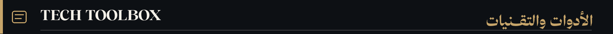

<div align="center">

</div>

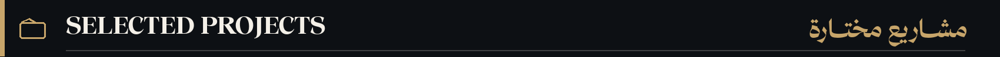

<div align="center">
<a href="https://brghr.vercel.app">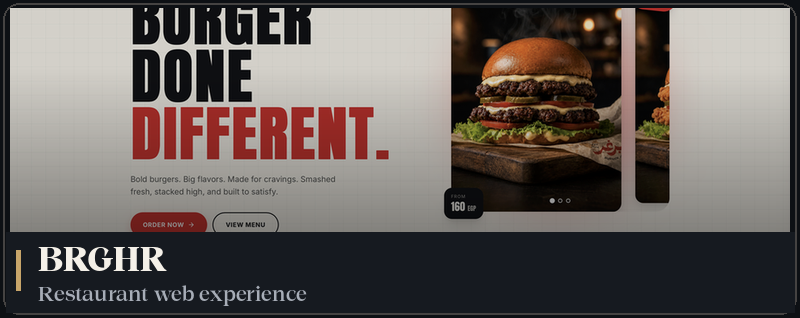</a>
<a href="https://github.com/AhmedKhaledHussein/aou-planner">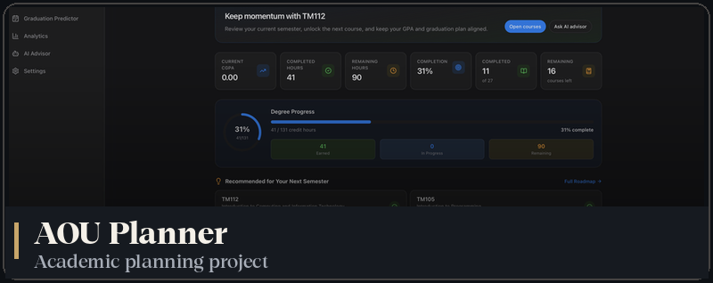</a>
<a href="https://scented-realms.vercel.app">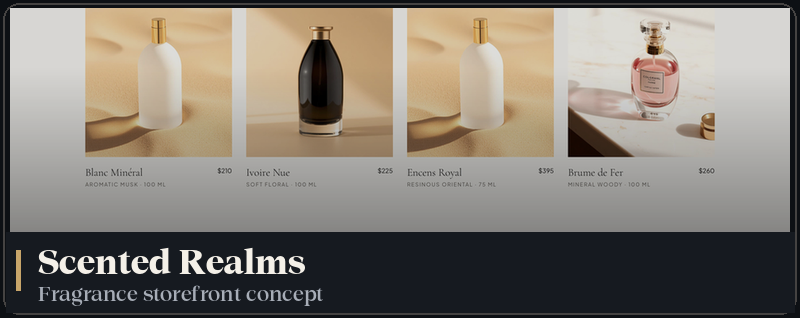</a>
<a href="https://ahmedkhaledhussein.vercel.app">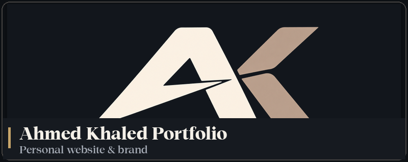</a>
</div>

**Explore my work:** [Portfolio](https://ahmedkhaledhussein.vercel.app) · [GitHub repositories](https://github.com/AhmedKhaledHussein?tab=repositories) · [Neural Vision Suite](https://ahmedkhaledhussein.vercel.app/#work)

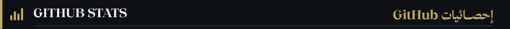

<div align="center">
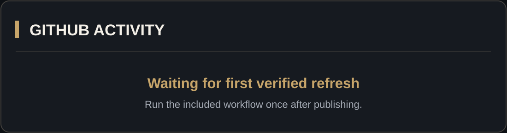
<br/>
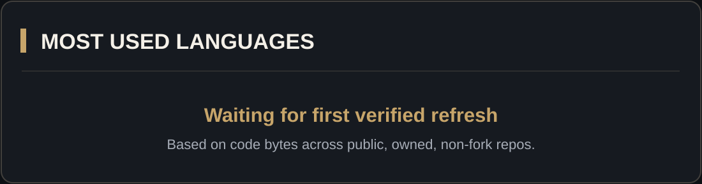
</div>

<sub>Stats are generated from GitHub data (rolling 12 months for activity; public, owned, non-fork repositories for languages). They update after the optional workflow is enabled and successfully run. This is not a ranking of programming proficiency.</sub>

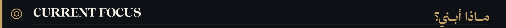

- ⚡ Full-stack web applications and reliable backends
- 🤖 Practical AI features and computer-vision experiments
- ✨ Thoughtful UI/UX and fast, responsive interfaces
- 📚 Continuing to learn through applied projects

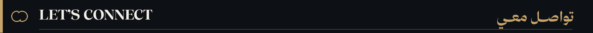

<div align="center">

<a href="https://ahmedkhaledhussein.vercel.app"></a>
<a href="https://www.linkedin.com/in/ahmedkhaledhussein/"></a>
<a href="mailto:Ahmed.khaaledh@gmail.com"></a>
<a href="https://wa.me/201043263308"></a>

<sub>Ahmed Khaled Hussein · أحمد خالد حسين · Software Engineering × Product Thinking</sub>

</div>
