

  

  

Software Engineering · Full-Stack Development · AI & Computer Vision

Cairo, Egypt · Computer Science, Arab Open University

---

I'm **Ahmed Khaled Hussein (أحمد خالد حسين)**, a software engineer and full-stack developer based in Cairo, Egypt, studying Computer Science at Arab Open University.

I build digital products by connecting software engineering with thoughtful user experience. My interests include **full-stack development, practical AI, and computer vision** — from the initial concept to working applications.

**أنا أحمد خالد حسين**، مهندس برمجيات ومطور تطبيقات ويب متكاملة. أدرس علوم الحاسب بالجامعة العربية المفتوحة، وأهتم ببناء حلول رقمية تجمع بين تطوير البرمجيات والذكاء الاصطناعي والرؤية الحاسوبية وتجربة المستخدم.

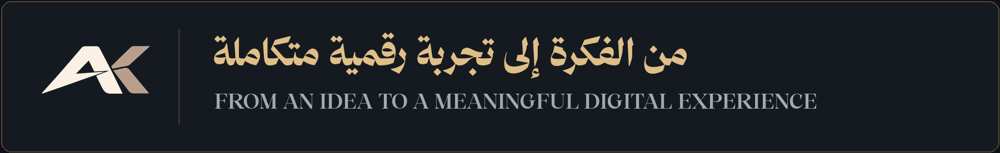

---

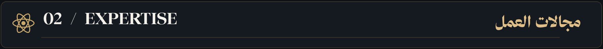

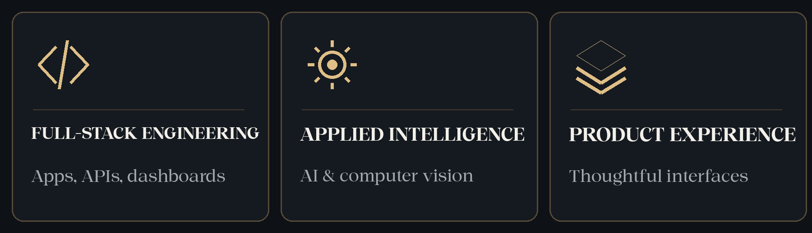

---

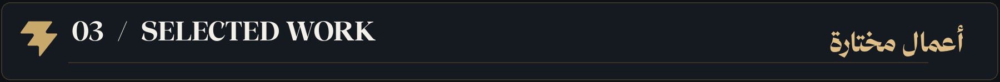

<a href="https://brghr.vercel.app">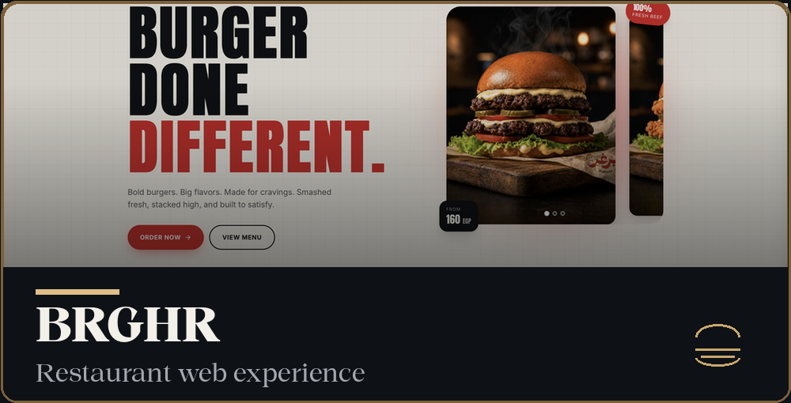</a>
<a href="https://aou-planner.vercel.app">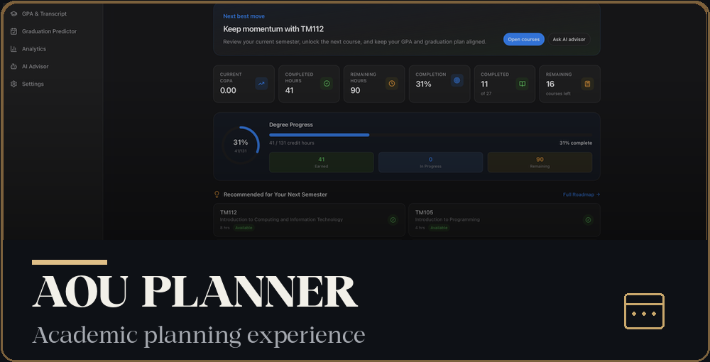</a>
<a href="https://scented-realms.vercel.app">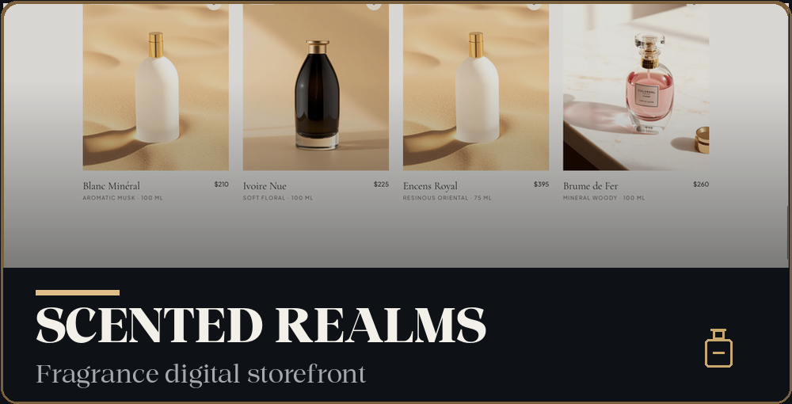</a>
<a href="https://ahmedkhaledhussein.vercel.app">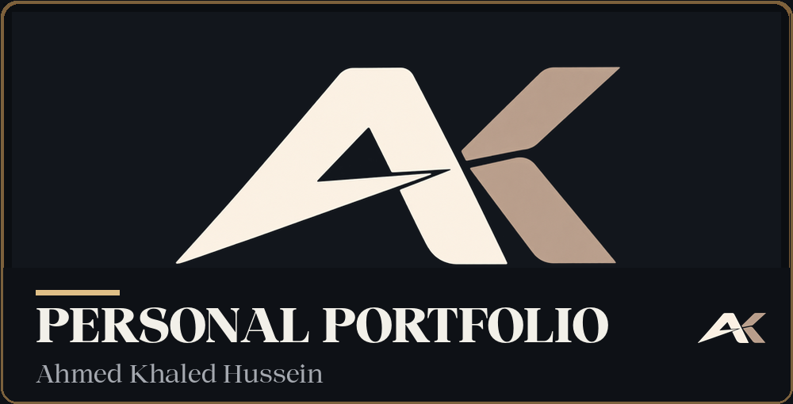</a>

**Additional project:** [Neural Vision Suite](https://ahmedkhaledhussein.vercel.app/#work), exploring detection, tracking and visual analysis.

**Code:** [Portfolio repository](https://github.com/AhmedKhaledHussein/Ahmed-Khaled-Portfolio) · [AOU Planner](https://github.com/AhmedKhaledHussein/aou-planner) · [More repositories](https://github.com/AhmedKhaledHussein?tab=repositories)

---

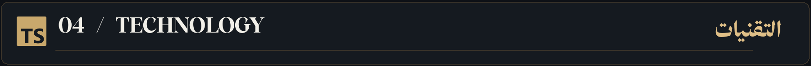

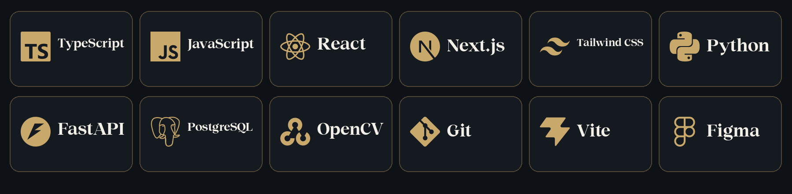

Tools and frameworks are selected according to each project's needs, from interfaces and APIs to data-backed applications and computer-vision workflows.

---

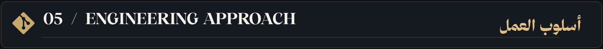

| Understand | Design | Build | Refine |
| :-- | :-- | :-- | :-- |
| Define the real problem | Plan a clear experience | Implement a reliable solution | Test, learn and improve |

My priorities: **clear interfaces, maintainable software, responsive design, performance and purposeful motion**.

---

Open to conversations about software engineering, full-stack products, applied AI and collaboration.

  

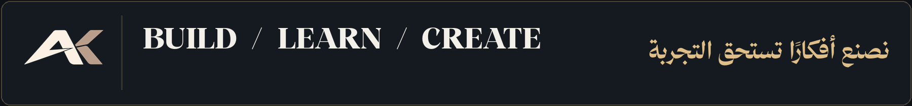

Ahmed Khaled Hussein · أحمد خالد حسين · Cairo, Egypt

