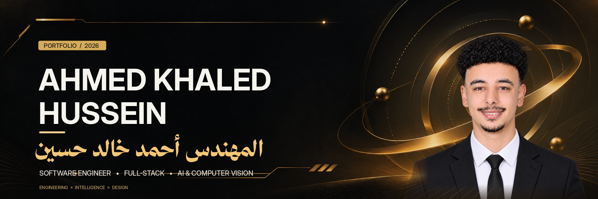
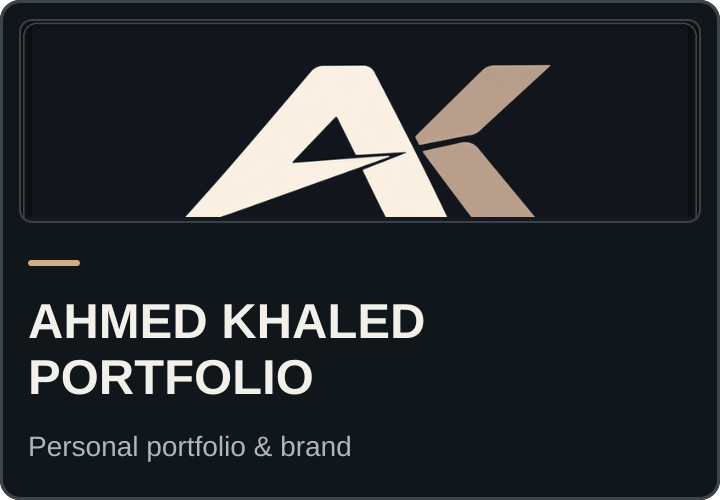
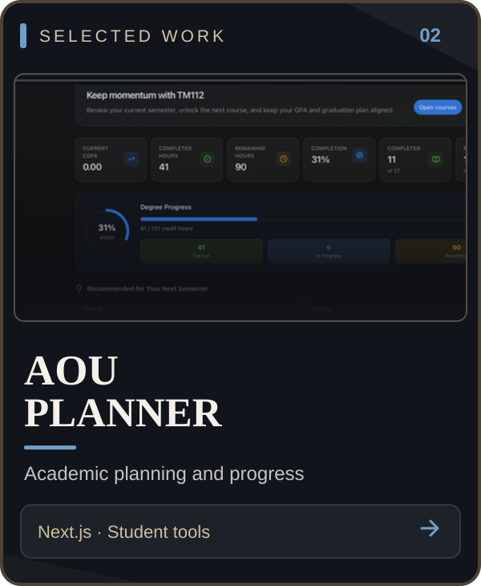
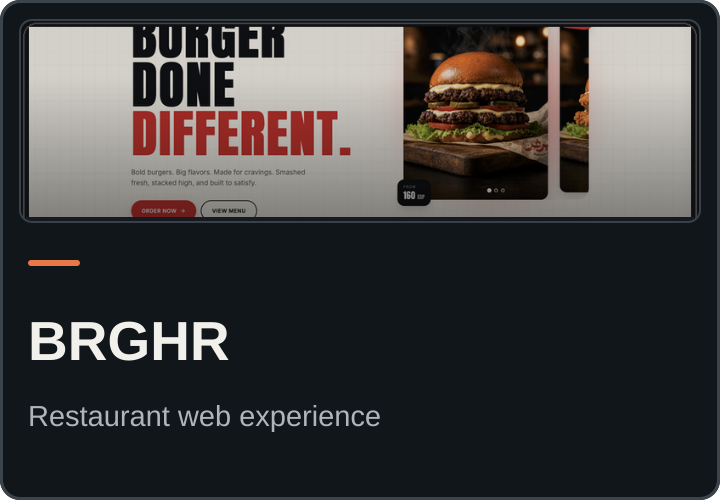
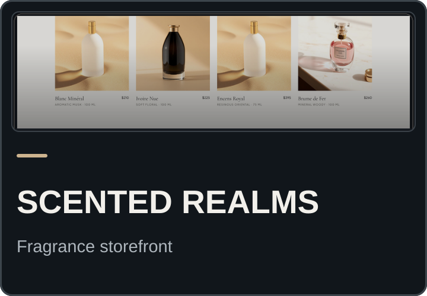
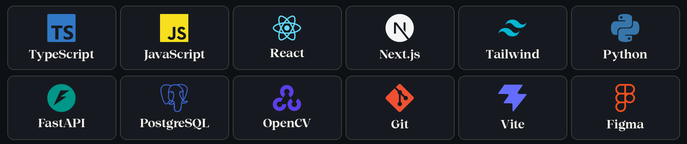

<div align="center">
  
</div>

<h1 align="center">Ahmed Khaled Hussein | أحمد خالد حسين</h1>

<p align="center">
  <strong>Software Engineer · Full-Stack Developer · AI & Computer Vision</strong><br/>
  Computer Science Student — Arab Open University · Cairo, Egypt
</p>

<div align="center">
  <a href="https://ahmedkhaledhussein.vercel.app"></a>
  <a href="https://www.linkedin.com/in/ahmedkhaledhussein/"></a>
</div>

---

## 👨‍💻 About Me | نبذة عني

I build full-stack web experiences that combine **clear design, useful functionality, and thoughtful engineering**. I study Computer Science at Arab Open University and explore practical applications of **AI and computer vision**.

أنا **أحمد خالد حسين**، أدرس علوم الحاسب في الجامعة العربية المفتوحة، وأطوّر تطبيقات ويب متكاملة. أهتم بجودة تجربة المستخدم وتطبيقات الذكاء الاصطناعي والرؤية الحاسوبية.

```ts
const ahmed = {
  name: "Ahmed Khaled Hussein",
  location: "Cairo, Egypt",
  education: "Computer Science · Arab Open University",
  work: ["Full-Stack Web Development", "Software Engineering"],
  interests: ["AI", "Computer Vision", "UI/UX"],
  principle: "Build useful things, beautifully.",
} as const;
```

---

## 🚀 Selected Projects | مشاريعي

Four selected projects, presented as one cohesive row. Every card opens its live preview.

<table>
  <tr>
    <td width="25%" align="center" valign="top">
      <a href="https://ahmedkhaledhussein.vercel.app"></a><br/>
      <sub><a href="https://ahmedkhaledhussein.vercel.app">Live Preview</a> · <a href="https://github.com/AhmedKhaledHussein/Ahmed-Khaled-Portfolio">Source Code</a></sub>
    </td>
    <td width="25%" align="center" valign="top">
      <a href="https://aou-planner.vercel.app"></a><br/>
      <sub><a href="https://aou-planner.vercel.app">Live Preview</a> · <a href="https://github.com/AhmedKhaledHussein/aou-planner">Source Code</a></sub>
    </td>
    <td width="25%" align="center" valign="top">
      <a href="https://brghr.vercel.app"></a><br/>
      <sub><a href="https://brghr.vercel.app">Live Preview</a></sub>
    </td>
    <td width="25%" align="center" valign="top">
      <a href="https://scented-realms.vercel.app"></a><br/>
      <sub><a href="https://scented-realms.vercel.app">Live Preview</a></sub>
    </td>
  </tr>
</table>

<sub>Previews use actual project screenshots. On narrower screens, scroll the project row horizontally if needed.</sub>

**More explorations:** [Neural Vision Suite and other work](https://ahmedkhaledhussein.vercel.app/#work) · [All public repositories](https://github.com/AhmedKhaledHussein?tab=repositories)

---

## 🧰 Tech Toolbox | الأدوات والتقنيات

<div align="center">
  
</div>

**Frontend:** TypeScript · JavaScript · React · Next.js · Tailwind CSS  
**Backend & Data:** Python · FastAPI · PostgreSQL  
**AI & Tools:** OpenCV · Git · Vite · Figma

*I choose tools based on what each project needs; this is a toolbox, not a proficiency ranking.*

---

## ✨ Highlights & Current Focus | أبرز الأعمال والاهتمامات

- 🌐 **Full-stack products:** Building accessible, responsive interfaces connected to practical application workflows.
- 🧩 **Applied projects:** Exploring academic planning, restaurant experiences, and digital storefronts.
- 👁️ **AI & computer vision:** Developing my knowledge through experiments and projects including Neural Vision Suite.
- 🎨 **Product quality:** Prioritizing clear UX, maintainable code, and purposeful interaction.

---

## 🤝 Let's Connect | تواصل معي

Interested in discussing software engineering, web products, or a potential collaboration? You can reach me here.

<div align="center">
  <a href="https://ahmedkhaledhussein.vercel.app"></a>
  <a href="https://www.linkedin.com/in/ahmedkhaledhussein/"></a>
  <br/>
  <a href="mailto:Ahmed.khaaledh@gmail.com"></a>
  <a href="https://wa.me/201043263308"></a>
  <br/><br/>
  <sub>Ahmed Khaled Hussein · أحمد خالد حسين · Software Engineering × Product Thinking</sub>
</div>
